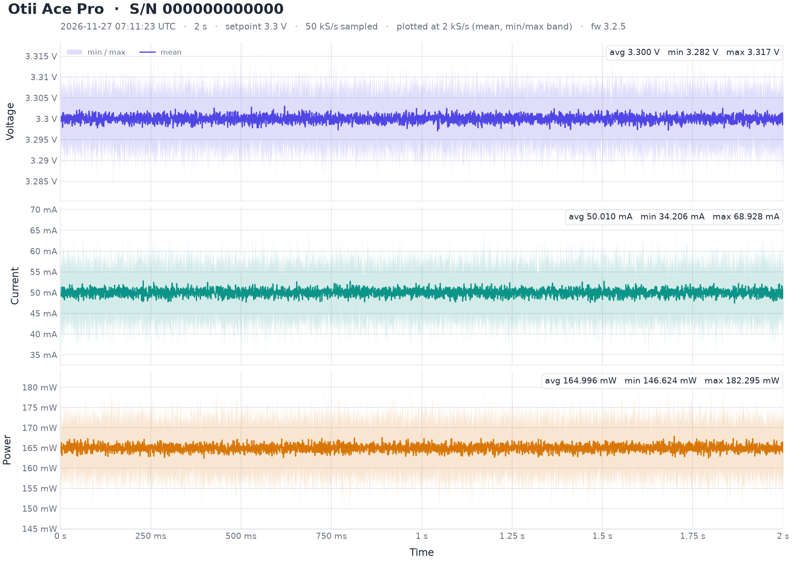

# otii-ace-mcp

Python driver, interactive CLI and MCP server for the **Qoitech Otii Ace Pro** power analyzer.
It talks to the device directly over USB and turns it into a building block for automation:
scripts, CI pipelines, lab test benches, and AI agents that debug hardware on their own.

> **Tested device:** Otii Ace Pro (hardware rev 2, firmware 3.2.5). The driver identifies the
> device on connection and refuses to operate anything it has not been tested with.



## Why

**Automation.** Everything the tool does is a Python call or a one-line command with JSON
output: power the device under test, measure voltage, current and power at 50 kS/s, record to CSV
and plots, power-cycle. No GUI in the loop, so the same steps run on a desk, in CI and on a test
rack.

**Automated debugging over MCP.** The MCP server gives an agent hands and eyes on the hardware.
It can flash new firmware, power-cycle the board, record the boot current and read the numbers
back, then compare against the last build: a sleep current that went from 3 µA to 300 µA, a
brown-out at start-up, a radio that never powers down. The agent closes the loop itself
(change → power → measure → reason → change) and leaves CSV files and plots behind for you to
check. Safety is built in: outputs are off and limits are set (5 V, 500 mA) whenever the server
starts or stops, and tools that switch power are marked so the client asks first.

**Easy to extend in Python.** The layers are small and typed. A new device setting is one
`PropertySpec` line; a new analysis is a `SampleSink` that receives numpy arrays; a new command
appears in the CLI, the interactive shell and its completion from one entry in the command
catalogue. The built-in simulator lets you develop and test all of it without hardware.

## Quickstart

### First-time setup

```sh
git clone https://github.com/bitqan-ae/otii-ace-mcp.git
cd otii-ace-mcp
python3 -m venv .venv                 # create the virtual environment (once)
source .venv/bin/activate             # load it
pip install -r requirements.txt       # dependencies + this package (editable)
otii-usb --simulate status            # works without hardware
```

Plug in the Otii Ace Pro over USB; it shows up as `/dev/ttyACM*` (`lsusb`: `0fce:d1e6`). If the
port is not accessible, add yourself to the `dialout` group and log in again.

### Every new terminal

```sh
cd otii-ace-mcp
source .venv/bin/activate             # load the venv; `deactivate` leaves it
otii-usb status
```

Without activating, call the tools directly: `.venv/bin/otii-usb`, `.venv/bin/otii-usb-mcp`.

## Command line

```sh
otii-usb status                          # identity, output state, setpoint, current limit
otii-usb measure -t 2                    # 2 s average/min/max of voltage, current, power
otii-usb record -t 60                    # 60 s to otii-<timestamp>.csv and .png
otii-usb record -t 10 --csv run.csv      # CSV only (1000 averaged rows per second)
otii-usb record -t 5 --png boot.png      # plot only
otii-usb record -t 2 --csv fast.csv --raw   # every sample (50 kHz)
otii-usb output on | off                 # switch the main output
otii-usb power-cycle -o 2                # off for 2 s, then on
otii-usb safe                            # all outputs off, 5 V setpoint, 500 mA limit
otii-usb --json measure                  # machine-readable output
otii-usb record --help                   # options and examples for any command
```

Ctrl-C (or SIGTERM/SIGHUP) stops the running command, switches all outputs off and restores the
5 V / 500 mA defaults. Timed operations show a progress bar on the terminal.

## Interactive mode

```sh
otii-usb -i                  # or: otii-usb --simulate -i to try it without hardware
```

The shell starts with a banner, puts the device into the safe state and shows the main output
state in the prompt. Tab completes commands, options and file names; ↑ and Ctrl-R search the
history (kept in `~/.local/state/otii-usb/history`); grey text suggests from history.

Example session (values depend on your device under test):

```text
  ___   _____  ___  ___        _      ____  _____
 / _ \ |_   _||_ _||_ _|      / \    / ___|| ____|
| | | |  | |   | |  | |      / _ \  | |    |  _|
| |_| |  | |   | |  | |     / ___ \ | |___ | |___
 \___/   |_|  |___||___|   /_/   \_\ \____||_____|
  Otii Ace Pro  ·  USB control & measurement  ·  otii-usb 0.1.0

Otii Ace Pro  S/N <serial> · fw 3.2.5 · /dev/ttyACM0
✔ safe state: outputs OFF, 5 V setpoint, 500 mA limit

otii Ace Pro ○ OFF ❯ output on
✔ main output OFF -> ON
otii Ace Pro ● ON ❯ measure -t 2
✔ main output ON, 2 s window
channel          avg          min          max          std    samples
mv         5.0000 V     4.9986 V     5.0031 V   452.1 µV    100,050
mc        12.3184 mA   11.9620 mA   12.7741 mA   97.4 µA    100,050
mp        61.5922 mW   59.8094 mW   63.8817 mW  487.2 µW    100,050
otii Ace Pro ● ON ❯ record -t 30 --csv boot.csv --png boot.png
| recording ━━━━━━━━━━━━━━━━━━╸━━━━━━━━━━━━━━━━━━  52% 0:00:15 eta 0:00:14
✔ recorded 30 s
  csv  /home/me/boot.csv  (30001 rows, 1000 rows/s)
  png  /home/me/boot.png
otii Ace Pro ● ON ❯ power-cycle -o 2
✔ main output ON -> OFF for 2 s -> ON
otii Ace Pro ● ON ❯ help record
otii Ace Pro ● ON ❯ exit
switching outputs off ...
✔ outputs OFF, defaults restored. bye.
```

More examples at the prompt:

```text
help                                   list all commands with an example each
help power-cycle                       options and examples for one command
status                                 device identity and state
measure -t 0.1                         quick 100 ms reading
record                                 10 s, CSV and PNG with timestamped names
record -t 60 --csv --png               both outputs, timestamped names
record --csv slow.csv --rate 10        10 averaged rows per second
safe --voltage 3.3 --current-limit 0.1 outputs off, then 3.3 V and 100 mA
clear                                  clear the screen
```

Ctrl-C at the prompt clears the line; during a command it stops the command and switches the
outputs off. `exit`, `quit` or Ctrl-D leave the shell with the outputs off.

## MCP server

```sh
otii-usb-mcp                          # stdio server for the attached Otii
otii-usb-mcp --simulate               # same, against the simulator
otii-usb-mcp --voltage 3.3 --current-limit 0.1 --output-dir ~/otii-records
```

Register it with Claude Code (from the repository, with the venv set up):

```sh
claude mcp add otii -- "$PWD/.venv/bin/otii-usb-mcp"
```

or use the `.mcp.json` in this repository, which starts `.venv/bin/otii-usb-mcp` when Claude Code
is opened in this directory. Other MCP clients start the same command over stdio.

| Tool | What it does |
|---|---|
| `status` | model, serial number, firmware, output state, voltage setpoint, current limit |
| `measure(duration_s)` | avg/min/max/std of voltage, current and power (≤ 10 s) |
| `record(duration_s, csv, png, rate_hz, name)` | CSV and/or PNG plot in the output directory (≤ 600 s) |
| `set_output(on)` | switch the main output (marked destructive) |
| `power_cycle(off_s)` | off, wait, on; always ends on (marked destructive) |

At start-up and at shutdown (client disconnect, Ctrl-C, SIGTERM, SIGHUP) the server switches the
main and expansion-port outputs off and sets 5 V / 500 mA. A tool that is still running is
cancelled first.

## Python API

```python
from otii_usb import ChannelId, OtiiDevice

with OtiiDevice.open() as otii:               # auto-detects the device, checks it is supported
    print(otii.model, otii.info().serial_number)
    otii.apply_safe_defaults()                # outputs off, 5 V, 500 mA
    otii.set_output(True)
    summary = otii.measure(1.0)
    print(summary.current.mean, summary.power.maximum)

    recording = otii.record(2.0)              # numpy float64 arrays per channel
    current = recording[ChannelId.MC]         # amperes, 50 kS/s

    otii.capture(10.0, csv="run.csv", png="run.png")
    otii.set_output(False)
```

Extending it, for example with a new device setting:

```python
from otii_usb.device import PropertySpec, ScaledIntCodec
from otii_usb.protocol import PropertyId

EXPANSION_VOLTAGE = PropertySpec("expvolt", PropertyId.EXPANSION_VOLTAGE, ScaledIntCodec(1e-6),
                                 unit="V")
with OtiiDevice.open() as otii:
    print(otii.get(EXPANSION_VOLTAGE))        # read-only unless writable=True
```

or with a live analysis that receives every packet as numpy arrays:

```python
from otii_usb import ChannelId, OtiiDevice
from otii_usb.measurement import SampleSink

class PeakCurrent(SampleSink):
    def __init__(self):
        self.peak = 0.0

    def write(self, sequence, samples):           # one call per 1 ms packet
        if ChannelId.MC in samples:
            self.peak = max(self.peak, float(samples[ChannelId.MC].max()))

with OtiiDevice.open() as otii:
    sink = PeakCurrent()
    otii.stream(sink, 5.0)
    print(f"peak current {sink.peak * 1e3:.3f} mA")
```

## Safety

* Only the tested device (Otii Ace Pro, firmware 3.2.x) is operated; identification only reads.
* Safe state (main and expansion outputs off, 5 V, 500 mA) when the MCP server or interactive
  shell starts, and on every exit; Ctrl-C/SIGTERM/SIGHUP switch the outputs off within
  milliseconds, also while a long recording runs.
* Only explicitly writable settings can be changed, and every change is read back.

The full list of numbered safety and design requirements, the architecture and the protocol
reference are in [docs/design.md](docs/design.md).

## Development

```sh
source .venv/bin/activate
python -m pytest                      # runs entirely against the simulator
otii-usb --debug --simulate measure   # protocol traffic as hex
```

CI runs the tests on Python 3.12, 3.13 and 3.14. Agent and contributor guidance is in
[AGENTS.md](AGENTS.md).

## License

Copyright (c) 2026 Milosch Meriac, developed at Bitqan Systems Design (bitqan.ae).
Licensed under the [Apache License 2.0](LICENSE).

This project was developed with the help of Anthropic's Claude Code.
