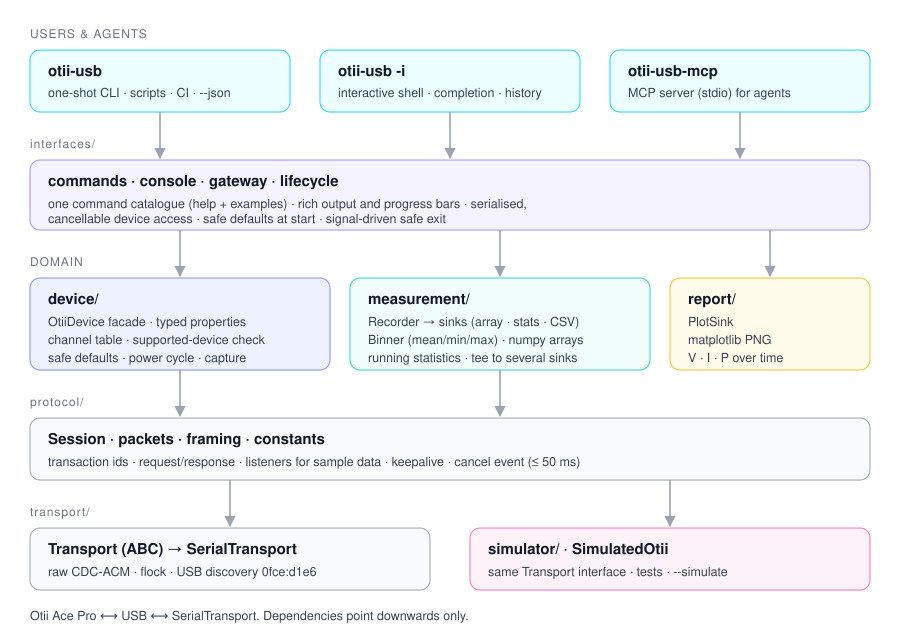
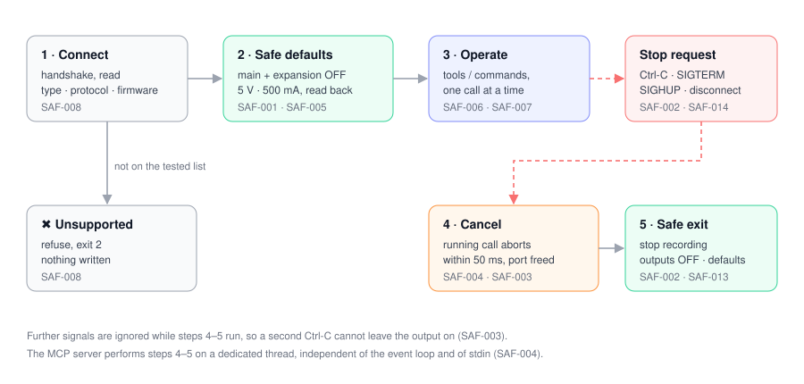

# otii-usb: design

The requirements, design constraints and process rules of `otii-usb`, and the code review
guideline. For contributors and agents working on this repository; users start with the
[README](../../README.md).

## Identifiers

Requirements say what the software shall do; design constraints record decisions, facts about
the hardware and host, and the rules of the process.

* Format: `REQ-<CLASS>-<SUBCLASS>-<NNN>` for requirements, `DC-<CLASS>-<SUBCLASS>-<NNN>` for
  design constraints, for example `REQ-SAFE-OUT-001` and `DC-HW-ACE-003`. Class and subclass
  together are a family.
* A family is defined on one page, its rows in the order of their numbers.
* Numbers count up within a family and are never reused. A new row takes the number after the
  highest one, not a gap: a gap is a row that was removed.
* If a row changes meaning, it is removed and a new identifier allocated. Rewording that keeps
  the meaning keeps the identifier.
* An identifier is cited as code, e.g. `REQ-SAFE-OUT-002`; the first citation on another page
  may link here. Source files cite the identifiers they implement in their header.

Columns of a requirement:

* **Source:** *Stated* (asked for by the project owner) or *Derived* (follows from another row,
  which it cites).
* **Status:** *Planned*, *Implemented* (in the code and covered by the offline tests) or
  *Verified* (also shown on a real Otii Ace Pro; the row is in [Verification](#verification)).

Basis of a design constraint:

* **Decided:** a choice of this project.
* **Source:** read in a document or upstream code, named in the row.
* **Measured:** seen on the hardware or host; the row gives the date.
* **Assumed:** inferred, not yet confirmed. Confirm on hardware before relying on it.

| Family | Scope | Defined in |
|---|---|---|
| `REQ-SAFE-OUT` | output state at start, exit and interruption | this page |
| `REQ-SAFE-DEV` | safe access to the device | this page |
| `REQ-SAFE-MON` | overcurrent monitoring | this page |
| `REQ-SAFE-MCP` | safety of the MCP interface | this page |
| `REQ-UI-CLI`, `REQ-UI-SHELL`, `REQ-UI-MCP` | user interfaces | this page |
| `REQ-MEAS-REC` | recording to CSV and PNG | this page |
| `REQ-PROT-LINK` | protocol handling | this page |
| `REQ-DOC-PROT`, `REQ-TEST-SIM` | documentation, tests | this page |
| `DC-ARCH-PKG`, `DC-ARCH-RUN` | package structure, run-time decisions | this page |
| `DC-HW-ACE` | facts about the Otii Ace Pro | this page; protocol facts in [protocol.md](protocol.md) |
| `DC-HOST-SIG` | facts about the host: signals, event loop | this page |
| `DC-TOOL-DOC`, `DC-TOOL-PY`, `DC-TOOL-REV`, `DC-TOOL-TEST` | process: documents, Python, reviews, tests | this page; summarised in [AGENTS.md](../../AGENTS.md) |

## Architecture



| Package | Holds |
|---|---|
| `transport/` | the byte pipe: `Transport` ABC, `SerialTransport` (raw CDC-ACM, exclusive `flock`), USB discovery via sysfs |
| `protocol/` | the wire format without device semantics: frames, typed packets, `Session` (transactions, listeners, keepalive, cancellation, progress) |
| `device/` | the device model: typed property specifications and codecs, channel table, tested-device table, `OtiiDevice` |
| `measurement/` | `Recorder`, sinks (array, statistics, CSV, tee), `Binner` |
| `report/` | `PlotSink` and PNG rendering with matplotlib |
| `simulator/` | `SimulatedOtii`, a `Transport` that emulates the device |
| `interfaces/` | command catalogue, console and progress bars, `DeviceGateway`, lifecycle and signals, overcurrent monitor, CLI, interactive shell, MCP server |

Recording data flow: the device sends one data packet per millisecond; `Session` hands it to the
recorder's router, which decodes each block into a numpy array and gives it to a `SampleSink`.
`TeeSink` feeds several sinks from one recording, so CSV and PNG come from the same samples.

```
Otii ──1 ms packets──▶ Session ──DataPacket──▶ Recorder ──numpy arrays──▶ SampleSink
                                                                            ├─ ArraySink → Recording
                                                                            ├─ CsvSink   → Binner → CSV rows
                                                                            └─ PlotSink  → Binner → PNG
```



## Requirements

<!-- &numsp; in the ID column headers keeps the identifier column wide. -->

### SAFE-OUT: Output state

| ID&numsp;&numsp;&numsp;&numsp;&numsp;&numsp;&numsp;&numsp; | Requirement | Source | Status |
|---|---|---|---|
| `REQ-SAFE-OUT-001` | When the MCP server or the interactive shell starts, it shall switch the main output and the expansion-port output off and set the voltage setpoint to 5 V and the current limit to 500 mA (both configurable with `--voltage` and `--current-limit`) before any other operation. If no device is attached, this shall happen on the first connection, before the first command. | Stated | Verified |
| `REQ-SAFE-OUT-002` | Every way of ending the MCP server or the interactive shell (Ctrl-C, SIGTERM, SIGHUP, client disconnect, `exit`, end of input) shall leave the device with recording stopped, all outputs off and the start-up defaults restored. | Stated | Verified |
| `REQ-SAFE-OUT-003` | The shutdown sequence shall not be interruptible by further signals; only SIGKILL stops it (`REQ-SAFE-OUT-002`). | Derived | Implemented |
| `REQ-SAFE-OUT-004` | After a stop request the outputs shall go off promptly also while a long operation runs or the server waits for its client: blocking reads from the device are cancellable within 50 ms, a write waits at most 2 s, and the process exits within 3 s (`DC-HOST-SIG-002`). | Derived | Verified |
| `REQ-SAFE-OUT-005` | The command line shall, on Ctrl-C, SIGTERM or SIGHUP, stop the command, switch all outputs off, restore the defaults and exit with 130. | Stated | Verified |
| `REQ-SAFE-OUT-006` | In the interactive shell, Ctrl-C during a command shall stop it and switch the outputs off while the session continues, and the prompt shall show the main output state. | Derived | Implemented |
| `REQ-SAFE-OUT-007` | SIGTERM and SIGHUP shall be handled like Ctrl-C, and Ctrl-C shall work also when the process inherited SIGINT as ignored (`DC-HOST-SIG-001`). | Derived | Verified |
| `REQ-SAFE-OUT-008` | A power cycle always ends with the main output on; the command help, the MCP tool description and the README shall say so. | Derived | Implemented |

### SAFE-DEV: Device access

| ID&numsp;&numsp;&numsp;&numsp;&numsp;&numsp;&numsp;&numsp; | Requirement | Source | Status |
|---|---|---|---|
| `REQ-SAFE-DEV-001` | Only tested devices (`DC-HW-ACE-001`: device type, protocol and firmware version must match exactly) shall be operated. Identification shall only read; an unsupported device shall be refused before any write, and the MCP server and the interactive shell shall not start (exit 2). | Stated | Implemented |
| `REQ-SAFE-DEV-002` | Every safety-relevant write shall be verified by reading it back; a mismatch is an error. | Derived | Verified |
| `REQ-SAFE-DEV-003` | Only properties marked writable shall be set; any other write is refused before anything is sent. | Derived | Implemented |
| `REQ-SAFE-DEV-004` | The voltage setpoint shall be checked against the device's reported maximum and the current limit shall be positive; MCP parameters shall be clamped (measure ≤ 10 s, record ≤ 600 s, off time 0.05–60 s). | Derived | Implemented |
| `REQ-SAFE-DEV-005` | A recording shall always be stopped and its channels disabled, also when interrupted; the safe shutdown shall stop a recording left running. | Derived | Implemented |
| `REQ-SAFE-DEV-006` | A device shall be used by one process at a time. | Derived | Implemented |
| `REQ-SAFE-DEV-007` | Only the commands listed in [protocol.md](protocol.md) shall be sent to the device. | Derived | Implemented |

### SAFE-MON: Monitoring

| ID&numsp;&numsp;&numsp;&numsp;&numsp;&numsp;&numsp;&numsp; | Requirement | Source | Status |
|---|---|---|---|
| `REQ-SAFE-MON-001` | While the interactive shell or the MCP server is idle, the device shall be polled (default every 1 s) and a current reaching the current limit, a current above 90 % of it, and an output switched off by the device shall be reported: in the shell in bold red (yellow for 90 %), by the MCP server in the next tool result. Finished measurements and recordings shall be checked against the limit. The output is not switched off by `otii-usb` (`DC-ARCH-RUN-004`). | Stated | Implemented |

### SAFE-MCP: MCP interface

| ID&numsp;&numsp;&numsp;&numsp;&numsp;&numsp;&numsp;&numsp; | Requirement | Source | Status |
|---|---|---|---|
| `REQ-SAFE-MCP-001` | MCP tools shall be annotated: reads `read_only_hint`, output switching `destructive_hint`, so clients ask before switching power. | Derived | Implemented |
| `REQ-SAFE-MCP-002` | Files written for MCP clients shall stay inside the configured output directory (plain names only). | Derived | Implemented |

### UI: User interfaces

| ID&numsp;&numsp;&numsp;&numsp;&numsp;&numsp;&numsp;&numsp; | Requirement | Source | Status |
|---|---|---|---|
| `REQ-UI-CLI-001` | `otii-usb` shall offer `status`, `measure`, `record`, `output`, `power-cycle` and `safe`; with `--json` a result shall be one JSON object on stdout and an error `{"error": …}`; exit codes 0 ok, 1 device error, 2 usage error or unsupported device, 130 interrupted. | Stated | Verified |
| `REQ-UI-CLI-002` | Every command shall have help text with examples, in `--help` and in the shell's `help`. | Stated | Implemented |
| `REQ-UI-CLI-003` | Operations with a known duration shall show a progress bar with an ASCII spinner and elapsed and remaining time, on terminals only and never in JSON output. | Stated | Implemented |
| `REQ-UI-CLI-004` | On start-up the device shall be identified on the terminal and in the MCP server's log: model, serial number, board serial, firmware, protocol version and port. | Stated | Verified |
| `REQ-UI-SHELL-001` | `otii-usb -i` shall offer an interactive shell with a banner, a prompt showing the main output state, input highlighting, completion of commands, options and file names, and a persistent history. | Stated | Implemented |
| `REQ-UI-MCP-001` | `otii-usb-mcp` shall offer the MCP tools `status`, `measure`, `record`, `set_output` and `power_cycle` over stdio. | Stated | Verified |

### MEAS-REC: Recording

| ID&numsp;&numsp;&numsp;&numsp;&numsp;&numsp;&numsp;&numsp; | Requirement | Source | Status |
|---|---|---|---|
| `REQ-MEAS-REC-001` | A recording shall write a CSV file with the columns `time_s,voltage_v,current_a,power_w`, averaged to a selectable row rate (default 1000 rows per second) or every sample; time from the packet sequence so that gaps stay visible; statistics over the full-rate samples; complete when interrupted. | Stated | Verified |
| `REQ-MEAS-REC-002` | A recording shall render a PNG plot of voltage, current and power over a shared time axis, with the mean and the min/max band, titled with the device model and serial number. | Stated | Verified |
| `REQ-MEAS-REC-003` | CSV and PNG shall be selectable individually or together, from one recording. | Stated | Verified |
| `REQ-MEAS-REC-004` | A recording shall optionally switch the main output on inside the recording, so that the power-up is recorded: only with the output off at the start, after the first data packet and a selectable pre-trigger time (default 50 ms), with the write read back (`REQ-SAFE-DEV-002`). The time the switch-on command was sent (the end of the last data packet received before it) shall be reported on the recording's time axis, marked in the PNG plot and in an extra CSV column `output_on`; the output's own response is left to the recording. The output shall be off at the end and after every error; a switch-off by the device during the recording shall be reported. The command line, the shell and the MCP `record` tool shall offer it. | Stated | Verified |

### PROT-LINK: Protocol handling

| ID&numsp;&numsp;&numsp;&numsp;&numsp;&numsp;&numsp;&numsp; | Requirement | Source | Status |
|---|---|---|---|
| `REQ-PROT-LINK-001` | The frame decoder shall accept arbitrary chunks and resynchronise after garbage and checksum errors. | Derived | Verified |
| `REQ-PROT-LINK-002` | Responses shall be matched by transaction id; other packets shall go to listeners; a keepalive shall be sent every 0.5 s while streaming; every wait shall have a time limit. | Derived | Verified |

### DOC, TEST: Documentation and tests

| ID&numsp;&numsp;&numsp;&numsp;&numsp;&numsp;&numsp;&numsp; | Requirement | Source | Status |
|---|---|---|---|
| `REQ-DOC-PROT-001` | The protocol shall be documented in [protocol.md](protocol.md) with colour-coded hex dumps of captured traffic and an explanation of the checksum. | Stated | Implemented |
| `REQ-TEST-SIM-001` | The whole offline test suite shall run without hardware, against a simulator that implements the same `Transport` interface. | Derived | Implemented |

### Verification

How each *Verified* requirement was shown on a real Otii Ace Pro (`DC-HW-ACE-001`).

| ID&numsp;&numsp;&numsp;&numsp;&numsp;&numsp;&numsp;&numsp; | Date | Evidence |
|---|---|---|
| `REQ-SAFE-OUT-001` | 2026-11-27 | MCP server started with the output on: output off, 5 V, 500 mA read back; `test_safe_state_applied_before_first_tool` |
| `REQ-SAFE-OUT-002` | 2026-11-27 | with the output on: MCP server stopped by SIGINT, SIGTERM and SIGHUP, interactive shell left with `exit`: output off, defaults read back each time; `test_mcp_server_signal_shutdown`, `test_session_loop_exits_with_outputs_off` |
| `REQ-SAFE-OUT-004` | 2026-11-27 | the same MCP runs: output off 0.06 s after the signal while the server was blocked reading stdin |
| `REQ-SAFE-OUT-005` | 2026-11-27 | `otii-usb measure -t 30` started as a background job with the output on, SIGINT: exit 130, output off; `test_cli_signal_during_measure` |
| `REQ-SAFE-OUT-007` | 2026-11-27 | as for `REQ-SAFE-OUT-005` (SIGINT inherited as ignored), SIGTERM and SIGHUP to the MCP server; `test_mcp_server_signal_shutdown`, `test_cli_signal_during_measure` |
| `REQ-SAFE-DEV-002` | 2026-11-27 | `otii-usb output on` / `off` and `safe`: main output, expansion output, setpoint and limit read back; `test_expansion_output_off_is_verified` |
| `REQ-UI-CLI-001` | 2026-11-27 | `status`, `measure`, `record`, `output`, `power-cycle`, `safe`, `--json status`, exit codes 0, 1 and 130; `TestCli`, `test_unsupported_device_exit_code_2` |
| `REQ-UI-CLI-004` | 2026-11-27 | `otii-usb status` lists serial number, board serial, firmware, protocol version 3 |
| `REQ-UI-MCP-001` | 2026-11-27 | stdio MCP client: tools listed, `status` and `measure` called |
| `REQ-MEAS-REC-001` | 2026-11-27 | `otii-usb record -t 3 --csv --png`: 3000 rows at 1000 rows/s, no missing packets; [`tests/test_csv.py`](../../tests/test_csv.py), [`tests/hardware/test_readonly.py`](../../tests/hardware/test_readonly.py) |
| `REQ-MEAS-REC-002` | 2026-11-27 | the same run: plot titled with model and serial number, reviewed |
| `REQ-MEAS-REC-003` | 2026-11-27 | the same run (both); one output each in `test_record_tool` |
| `REQ-MEAS-REC-004` | 2026-11-27 | `test_power_on_recording` with a device under test at 5 V / 1 A: command marked at 50 ms, output off before it, no missing packets, output off afterwards; plot reviewed; [`tests/test_power_on.py`](../../tests/test_power_on.py), [`tests/hardware/test_power_on.py`](../../tests/hardware/test_power_on.py) |
| `REQ-PROT-LINK-001` | 2026-11-27 | every hardware session; `TestFraming` |
| `REQ-PROT-LINK-002` | 2026-11-27 | captured session in [protocol.md](protocol.md#13-a-complete-session); `TestSession` |

## Design constraints

### ARCH-PKG: Package structure

| ID&numsp;&numsp;&numsp;&numsp;&numsp;&numsp;&numsp;&numsp; | Constraint | Basis |
|---|---|---|
| `DC-ARCH-PKG-001` | Packages are layered: `interfaces` → `device` / `measurement` / `report` → `protocol` → `transport`. Dependencies point downwards only; `simulator` uses `device` and `protocol`. | Decided |
| `DC-ARCH-PKG-002` | The byte transport is the `Transport` ABC. The serial implementation uses only the standard library (`termios`, `select`, `fcntl`), so the protocol stack runs unchanged against the simulator. | Decided |
| `DC-ARCH-PKG-003` | Device properties are typed (`PropertySpec[T]` with a `Codec[T]`) and listed in one catalogue (`Properties`); writability is part of the specification (`REQ-SAFE-DEV-003`). | Decided |
| `DC-ARCH-PKG-004` | Channel capabilities are read from the device (`chinfo`), not hard-coded. | Decided |
| `DC-ARCH-PKG-005` | Sample data is numpy float64 in SI units, decoded per block with `numpy.frombuffer`; no per-sample Python loops. | Decided |
| `DC-ARCH-PKG-006` | A recording streams into `SampleSink`s; CSV rows are written as data arrives, so memory does not grow with the recording length. | Decided |
| `DC-ARCH-PKG-007` | One command catalogue ([`interfaces/commands.py`](../../src/otii_usb/interfaces/commands.py)) builds the CLI subcommands, the shell's parser, help and completion (`REQ-UI-CLI-002`). | Decided |

### ARCH-RUN: Run-time decisions

| ID&numsp;&numsp;&numsp;&numsp;&numsp;&numsp;&numsp;&numsp; | Constraint | Basis |
|---|---|---|
| `DC-ARCH-RUN-001` | Each CLI command and each MCP tool call or shell command opens its own connection; `DeviceGateway` serialises calls, so the port is free between calls. | Decided |
| `DC-ARCH-RUN-002` | A stop signal to the MCP server or the shell wakes a thread started in advance that cancels running device I/O, applies the safe state over a connection not bound to the cancellation, and ends the process, independent of the event loop (`DC-HOST-SIG-002`, `-003`). | Decided |
| `DC-ARCH-RUN-003` | The overcurrent monitor polls only through `DeviceGateway.try_call`; a poll that finds the device busy is skipped, so it never delays a command. | Decided |
| `DC-ARCH-RUN-004` | Overcurrent protection is left to the device (`DC-HW-ACE-005`); `otii-usb` reports and does not switch the output off itself, because a 1 s software poll reacts far slower than the device. | Decided |

### HW-ACE: The Otii Ace Pro

| ID&numsp;&numsp;&numsp;&numsp;&numsp;&numsp;&numsp;&numsp; | Constraint | Basis |
|---|---|---|
| `DC-HW-ACE-001` | The tested device: USB `0fce:d1e6` (CDC-ACM), device type `Ace`, protocol 3, hardware rev 2, firmware 3.2.5, bootloader 3.2.2. | Measured 2026-11-27 |
| `DC-HW-ACE-002` | The main channels `mc`, `mv`, `mp` deliver float32 samples in SI units at 50 kS/s, in one data packet per millisecond. | Measured 2026-11-27 |
| `DC-HW-ACE-003` | The voltage setpoint is an integer in µV with a maximum of 25 V; the current limit reads and writes as float32 amperes at id `0x100c`. | Measured 2026-11-27 |
| `DC-HW-ACE-004` | The main output keeps its state when the port is closed. | Measured 2026-11-27 |
| `DC-HW-ACE-005` | The device enforces the current limit on its own, according to its current-limit mode (property `0x06`, value 1 on the tested unit). Which behaviour (limiting or switching off) that value selects has not been observed. | Assumed |
| `DC-HW-ACE-006` | Current ranging is automatic; the range override (`0x3c`) reads 0 and is never written. | Measured 2026-11-27 (read); behaviour Assumed |
| `DC-HW-ACE-007` | A property id the device does not know is answered with error code `0xfffffffd`. | Measured 2026-11-27 |

The wire protocol facts are in [protocol.md](protocol.md).

### HOST-SIG: Host behaviour

| ID&numsp;&numsp;&numsp;&numsp;&numsp;&numsp;&numsp;&numsp; | Constraint | Basis |
|---|---|---|
| `DC-HOST-SIG-001` | A shell starts background jobs with SIGINT ignored, and Python keeps that disposition. | Source: bash manual, "Signals"; Measured 2026-11-27 |
| `DC-HOST-SIG-002` | Cancelling the MCP server's asyncio event loop waits for its stdin reader thread, which is blocked until the client sends data or closes the pipe (36.7 s in the measurement). | Measured 2026-11-27 |
| `DC-HOST-SIG-003` | A Python signal handler runs in the main thread between two bytecodes, also in the middle of a write to stderr; a handler that writes to the same stream fails ("reentrant call") and the interrupt is lost. Signal handlers here therefore do no I/O and take no lock. | Measured 2026-11-27 |
| `DC-HOST-SIG-004` | Replacing a handler by `SIG_IGN` while a signal is pending makes CPython report "signal ignored due to race condition"; handlers are left installed and made to do nothing instead. | Measured 2026-11-27 |

### TOOL-DOC: Documents

| ID&numsp;&numsp;&numsp;&numsp;&numsp;&numsp;&numsp;&numsp; | Constraint | Basis |
|---|---|---|
| `DC-TOOL-DOC-001` | A page serves one audience: users read the [README](../../README.md), contributors and agents read `docs/contributor/` and [AGENTS.md](../../AGENTS.md). | Decided |
| `DC-TOOL-DOC-002` | A page starts with a title and one or two sentences saying what it is for and who reads it. It says what is, not what was: no history, no dates of decisions; a measurement keeps its date. | Decided |
| `DC-TOOL-DOC-003` | One fact, one place: a page links to the page that holds a fact instead of repeating it. Why: a fact written twice is corrected once. | Decided |
| `DC-TOOL-DOC-004` | Nothing personal or device-identifying goes into the repository: no serial numbers (device or board), certificates, usernames, home paths, host names or network addresses, in documents, figures, examples or test data. Placeholders (`<serial>`) or simulator values are used. The tools may print such data on the terminal. | Decided |
| `DC-TOOL-DOC-005` | A drawing is an SVG; its PNG is rendered from it (twice the size, `rsvg-convert`) and both are committed together. Drawings of captured data are generated by a script from the capture ([`docs/tools/protocol_figures.py`](../tools/protocol_figures.py)). | Decided |
| `DC-TOOL-DOC-006` | Every source file starts with the project's Apache-2.0 header: the file name and what it does, the copyright, the license notice and SPDX identifier, then how it works and the identifiers it implements. | Decided |
| `DC-TOOL-DOC-007` | A change starts with its requirement row; documents change in the same commit as the code. | Decided |
| `DC-TOOL-DOC-008` | A commit message says what changed and why, and cites the identifiers it implements or changes. It carries no tool or assistant attribution; the only such mention is the line in the README's License section. | Decided |
| `DC-TOOL-DOC-009` | Configuration files ([`pyproject.toml`](../../pyproject.toml), [`requirements.txt`](../../requirements.txt), CI workflows, [`.mcp.json`](../../.mcp.json) and the like) carry no copyright header; the license of the repository covers them. | Decided |
| `DC-TOOL-DOC-010` | A Markdown page that names a file of the repository links to it, with the name as written as the link text, e.g. [`protocol/framing.py`](../../src/otii_usb/protocol/framing.py); outside code blocks, and except for example names of files that do not exist. | Decided |

### TOOL-PY: Python

| ID&numsp;&numsp;&numsp;&numsp;&numsp;&numsp;&numsp;&numsp; | Constraint | Basis |
|---|---|---|
| `DC-TOOL-PY-001` | Python ≥ 3.12. Dependencies are numpy, matplotlib, rich, prompt_toolkit and mcp (pytest for tests), with minimum versions in [`pyproject.toml`](../../pyproject.toml) and [`requirements.txt`](../../requirements.txt); a development checkout uses the `.venv` set up from [`requirements.txt`](../../requirements.txt). | Decided |
| `DC-TOOL-PY-002` | Warnings are errors in the test suite (`filterwarnings = error`). | Decided |

### TOOL-REV: Reviews

| ID&numsp;&numsp;&numsp;&numsp;&numsp;&numsp;&numsp;&numsp; | Constraint | Basis |
|---|---|---|
| `DC-TOOL-REV-001` | Every change is reviewed against the [code review guideline](#code-review-guideline). A review reports its findings ranked by importance, each with file and line, a proposed fix and how certain it is (certain, likely, unsure); a finding marked unsure is confirmed against the code before it is changed. | Decided |

### TOOL-TEST: Tests

| ID&numsp;&numsp;&numsp;&numsp;&numsp;&numsp;&numsp;&numsp; | Constraint | Basis |
|---|---|---|
| `DC-TOOL-TEST-001` | A test writes files only in its own temporary directory: never in the repository, the current directory or a fixed path. | Decided |
| `DC-TOOL-TEST-002` | The offline suite needs no hardware (`REQ-TEST-SIM-001`). Hardware tests are under `tests/hardware/`, skip themselves without `--hardware`, are read-only unless a test says otherwise, and run one at a time. | Decided |
| `DC-TOOL-TEST-003` | Every test can fail: no assertion that always passes, no silent `if` that skips the check. | Decided |
| `DC-TOOL-TEST-004` | A test waits for what it waits for (a line of output, a state), not for a generous allowance of time. | Decided |
| `DC-TOOL-TEST-005` | New and changed tests run by themselves first; a test that failed runs again by itself after its fix, before the whole suite. | Decided |
| `DC-TOOL-TEST-006` | CI runs the offline suite and a simulator smoke test of the CLI on Python 3.12, 3.13 and 3.14. | Decided |
| `DC-TOOL-TEST-007` | A hardware test that switches the main output on is marked `switches_output` and runs only with `--switch-output` in addition to `--hardware`; it starts from the safe state and ends with the device shut down. | Decided |

## Code review guideline

A review answers these questions for every changed file (`DC-TOOL-REV-001`).

1. **Bugs.** Wrong results, unhandled errors, races, operations interrupted at any point (Ctrl-C, signals, unplugged device), resources not released.
2. **Architecture.** Does the change respect the layers (`DC-ARCH-PKG-001`) and put code where its job is?
3. **Standard library and upstream first.** Is there a standard-library or existing dependency function that does this?
4. **Duplication and dead code.** Is anything written twice, unused, or kept "for later"?
5. **Size and readability.** Can a function, class or file be smaller or clearer; do names say what things are?
6. **Comments against the code.** Do the file header, docstrings and comments still describe what the code does?
7. **Documents against the code.** Do README, this page, [protocol.md](protocol.md) and [AGENTS.md](../../AGENTS.md) still match; are statuses and verification rows current?
8. **Documentation coverage.** Is every user-visible behaviour documented, every new rule a row?
9. **Tests.** Is every behaviour tested; can each test fail (`DC-TOOL-TEST-003`); do the tests follow `DC-TOOL-TEST-001` to `-005`?
10. **Requirements.** Does every change trace to a requirement or constraint row, and the header cite it?
11. **Dependencies.** Are [`requirements.txt`](../../requirements.txt) and [`pyproject.toml`](../../pyproject.toml) free of stale and missing entries? Checked in every review, whatever its scope.

Also, by area:

| Area | Also |
|---|---|
| anything that touches the device | Are the outputs off on every exit path (`REQ-SAFE-OUT-002`)? Is every wait bounded (`REQ-PROT-LINK-002`)? Is every write read back (`REQ-SAFE-DEV-002`)? Is a new writable property verified on hardware first? |
| signals and threads | Can a signal arrive at any line, also before a thread starts or while a lock is held? Is shutdown independent of the event loop? |
| MCP tools | Annotations (`REQ-SAFE-MCP-001`), clamped parameters (`REQ-SAFE-DEV-004`), files only in the output directory (`REQ-SAFE-MCP-002`)? |
| documents, figures, tests | Any serial number or personal data (`DC-TOOL-DOC-004`)? |
