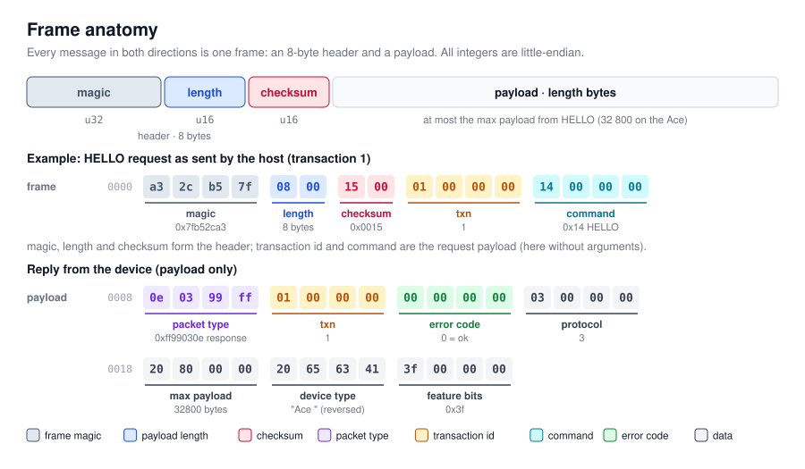
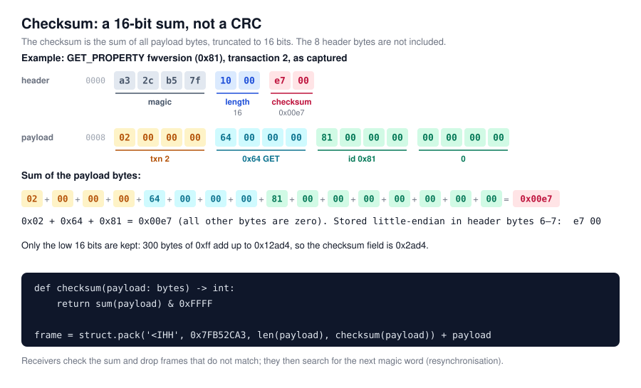
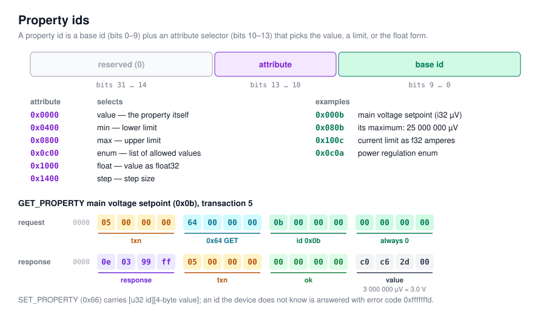
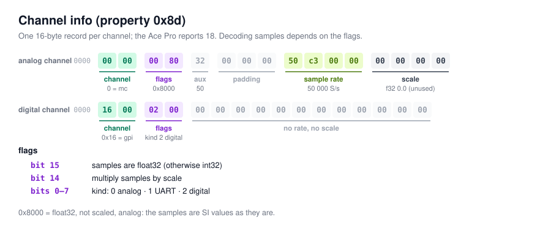
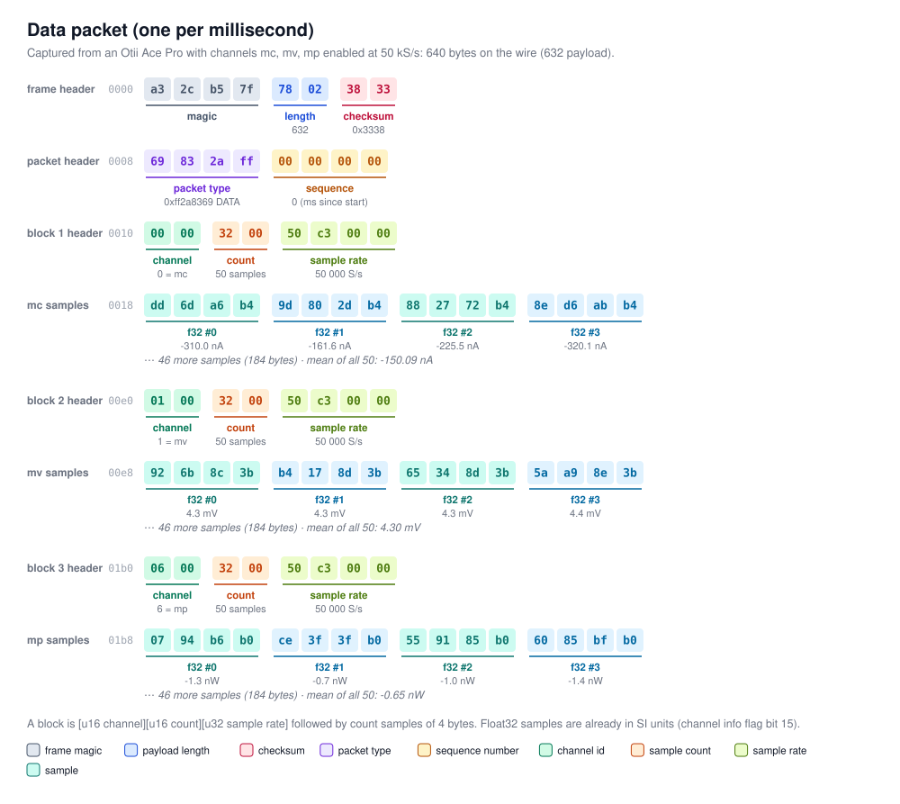
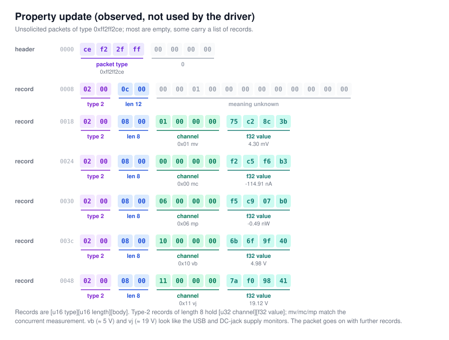
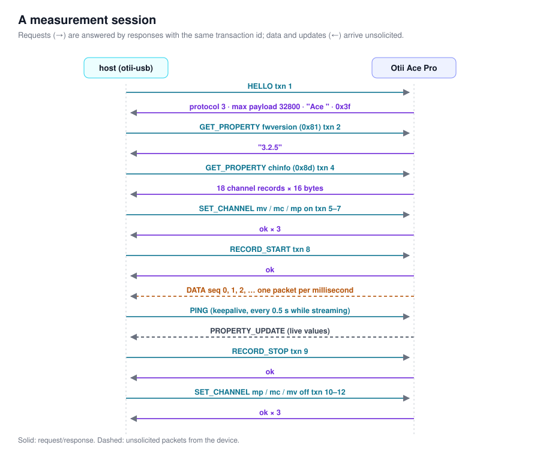

# Otii Ace Pro USB protocol

How a host talks to an **Otii Ace Pro** over USB, byte by byte: frames, the checksum,
requests and responses, properties, channels and the streamed data. For contributors who
change the driver or the simulator, and for anyone who wants to understand the traffic in a
`--debug` log.

Every byte sequence here was captured from an Otii Ace Pro with firmware 3.2.5 (protocol
version 3). The figures are generated from that capture by
[`docs/tools/protocol_figures.py`](../tools/protocol_figures.py); the SVG files in
[`docs/images/`](../images/) are the originals. Requirements that concern the protocol are in
[design.md](design.md): `REQ-PROT-LINK-001`, `REQ-PROT-LINK-002`, `REQ-SAFE-DEV-007`.

**Contents:**
[1 Link](#1-link) ·
[2 Byte order](#2-byte-order) ·
[3 Frames](#3-frames) ·
[4 Checksum](#4-checksum) ·
[5 Packets](#5-packets) ·
[6 Requests and responses](#6-requests-and-responses) ·
[7 Session start](#7-session-start) ·
[8 Properties](#8-properties) ·
[9 Channels](#9-channels) ·
[10 Recording and data packets](#10-recording-and-data-packets) ·
[11 Property updates](#11-property-updates-observed) ·
[12 Alerts](#12-alerts) ·
[13 Complete session](#13-a-complete-session) ·
[14 Implementation map](#14-implementation-map) ·
[15 What is verified](#15-what-is-verified)

---

## 1. Link

| | |
|---|---|
| USB | vendor `0x0fce`, product `0xd1e6`, manufacturer "Qoitech AB", product "Ace" |
| Class | CDC-ACM (virtual serial port), `/dev/ttyACM*` on Linux |
| Line settings | irrelevant for CDC-ACM; the port is put into raw 8N1 mode |
| Flow | full duplex; the host sends requests, the device sends responses and unsolicited packets |
| Ownership | one process at a time (`otii-usb` takes an exclusive `flock`) |

## 2. Byte order

All integers and floats are **little-endian**: the least significant byte comes first.
`0x7fb52ca3` is sent as `a3 2c b5 7f`; the 16-bit value `632` (`0x0278`) as `78 02`.
Floats are IEEE-754 single precision (`f32`), also little-endian.

## 3. Frames

Every message, in both directions, is one **frame**: an 8-byte header followed by a payload.



| Offset | Size | Field | Meaning |
|---|---|---|---|
| 0 | u32 | magic | always `0x7fb52ca3` (`a3 2c b5 7f`) |
| 4 | u16 | length | number of payload bytes (header not counted) |
| 6 | u16 | checksum | 16-bit sum of the payload bytes, see §4 |
| 8 | length | payload | a request or a packet, see §5 |

The maximum payload is announced by the device in the HELLO reply: 32 800 bytes on the Ace Pro.

The HELLO request as sent, annotated:

```text
a3 2c b5 7f   08 00   15 00   01 00 00 00   14 00 00 00
└── magic ──┘ └ len ┘ └ sum ┘ └── txn 1 ──┘ └─ HELLO ──┘
  0x7fb52ca3    8      0x15     txn = 1      cmd = 0x14
              └───── header (8 bytes) ────┘└──── payload (8 bytes) ────┘
```

## 4. Checksum

The checksum is **not a CRC**. It is the arithmetic sum of all payload bytes, truncated to
16 bits. The header itself is not included.



```python
def checksum(payload: bytes) -> int:
    return sum(payload) & 0xFFFF
```

Worked example, the GET_PROPERTY request for the firmware version (transaction 2) as captured:

```text
header   a3 2c b5 7f  10 00  e7 00
payload  02 00 00 00  64 00 00 00  81 00 00 00  00 00 00 00
         txn 2        GET (0x64)   id 0x81      0

sum = 0x02 + 0x64 + 0x81 = 0xe7      (the other 13 bytes are 0)
    → checksum field 0x00e7 → bytes e7 00
```

Only the low 16 bits are kept: 300 payload bytes of `0xff` add up to `0x12ad4`, so the
checksum field would be `0x2ad4`.

**Receiving.** A receiver reads bytes into a buffer and looks for the magic word. When a full
frame (8 + length bytes) is present it compares the checksum; a frame that does not match is
dropped and the search continues one byte after the bad magic word. Bytes between frames are
discarded. This resynchronises after noise or after text output (a device in text mode answers
lines such as `init:ok`).

## 5. Packets

The first 32-bit word of a payload says what it is.

| Direction | First word | Bytes on the wire | Packet |
|---|---|---|---|
| host → device | transaction id | (any) | request: `[u32 txn][u32 command][arguments]` |
| device → host | `0xff99030e` | `0e 03 99 ff` | response: `[type][u32 txn][u32 error code][data]` |
| device → host | `0xff2a8369` | `69 83 2a ff` | data: `[type][u32 sequence][sample blocks]` |
| device → host | `0xff2ff2ce` | `ce f2 2f ff` | property update: `[type][u32][records]` (§11) |
| device → host | `0xffc593ca` | `ca 93 c5 ff` | alert (§12) |

Requests never start with `0xff…` because transaction ids count up from 1.

## 6. Requests and responses

```text
request   [u32 txn] [u32 command] [arguments …]
response  0e 03 99 ff  [u32 txn] [u32 error code] [data …]
```

* The host numbers its requests: transaction ids start at 1 and increase by one per request.
* The device answers every request with a response carrying the **same transaction id**. The
  host matches responses by id; anything else that arrives meanwhile (data, updates) is handled
  separately.
* Error code `0` means success. A property id the device does not know is answered with
  `0xfffffffd` (−3 as a signed integer).
* The response data depends on the command; SET commands return no data.

| Command | Id | Arguments | Response data |
|---|---|---|---|
| PING | `0x0a` | 8 bytes `00` | — |
| HELLO | `0x14` | — | session information (§7) |
| GET_PROPERTY | `0x64` | `[u32 property id][u32 0]` | the value (§8) |
| SET_PROPERTY | `0x66` | `[u32 property id][4-byte value]` | — |
| SET_CHANNEL | `0x78` | `[u32 channel][u32 1 = on, 0 = off]` | — |
| RECORD_START | `0x7c` | — | — |
| RECORD_STOP | `0x7e` | — | — |

No other command ids are sent by `otii-usb` (`REQ-SAFE-DEV-007`).

**Keepalive.** While data is streaming, the host sends PING every 0.5 s; the device answers
with an ordinary response.

## 7. Session start

The host opens the port and sends HELLO. The reply, as captured:

```text
0e 03 99 ff  01 00 00 00  00 00 00 00  03 00 00 00  20 80 00 00  20 65 63 41  3f 00 00 00
response     txn 1        ok           protocol 3   max payload  device type  feature bits
                                                    32 800       "Ace "       0x3f
```

The device type is four ASCII characters stored as a little-endian u32: the bytes
`20 65 63 41` read backwards are `41 63 65 20` = `"Ace "`. `otii-usb` only operates a device
whose type is `Ace`, protocol `3` and firmware `3.2.5` (`REQ-SAFE-DEV-001`); the identification only reads.

If HELLO is not answered, the host writes the text line `\rinit\r\n` (`0d 69 6e 69 74 0d 0a`)
and tries again. With firmware 3.2.5 the binary HELLO is answered at once.

## 8. Properties

Device settings and information are **properties**, read with GET_PROPERTY and written with
SET_PROPERTY. A property id has two parts:



| Bits | Field | Values |
|---|---|---|
| 0–9 | base id | which property |
| 10–13 | attribute | `0x0000` value · `0x0400` min · `0x0800` max · `0x0c00` enum · `0x1000` value as f32 · `0x1400` step |

Properties used by `otii-usb`:

| Property | Id | Encoding | Example |
|---|---|---|---|
| name | `0x01` | ASCII string | `41 63 65` = "Ace" |
| main output | `0x09` | i32, 0 = off, 1 = on | `00 00 00 00` |
| main voltage setpoint | `0x0b` | i32 microvolts | `c0 c6 2d 00` = 3 000 000 µV = 3.0 V |
| main voltage maximum | `0x080b` | i32 microvolts | 25 000 000 µV |
| current limit | `0x100c` | f32 amperes | `00 00 00 3f` = 0.5 A |
| expansion output voltage | `0x34` | i32 microvolts, 0 = off | `00 00 00 00` |
| hardware version | `0x80` | string | "rev 2" |
| firmware version | `0x81` | string | `33 2e 32 2e 35` = "3.2.5" |
| serial number | `0x82` | string | 12 digits |
| board serial | `0x84` | string | two groups of 8 hex digits |
| bootloader version | `0x87` | string | "3.2.2" |
| channel info | `0x8d` | 16-byte records | §9 |

`0x0c` read without the float attribute returns the current limit as i32 milliamperes.
Writing is limited to main output, voltage setpoint, current limit and expansion output
(`REQ-SAFE-DEV-003`), and every write is read back (`REQ-SAFE-DEV-002`). Current ranging is automatic; `otii-usb`
never writes the range override.

Reading the main output state (transaction 3), as captured:

```text
request   03 00 00 00  64 00 00 00  09 00 00 00  00 00 00 00
          txn 3        GET          id 0x09      0
response  0e 03 99 ff  03 00 00 00  00 00 00 00  00 00 00 00
          response     txn 3        ok           value 0 = off
```

## 9. Channels

GET_PROPERTY `0x8d` returns the channel table: one 16-byte record per channel (18 on the Ace
Pro, 288 bytes).



| Offset | Size | Field |
|---|---|---|
| 0 | u16 | channel id |
| 2 | u16 | flags: bit 15 samples are f32 (else i32) · bit 14 multiply by scale · bits 0–7 kind (0 analog, 1 UART, 2 digital) |
| 4 | u8 | auxiliary value (50 for the 50 kS/s channels; meaning not known) |
| 5 | 3 | padding |
| 8 | u32 | sample rate in samples per second |
| 12 | f32 | scale (used when flag bit 14 is set) |

The main channels and their records on the Ace Pro:

| Channel | Id | Unit | Record |
|---|---|---|---|
| mc · main current | `0x00` | A | `00 00 00 80 32 00 00 00 50 c3 00 00 00 00 00 00` |
| mv · main voltage | `0x01` | V | `01 00 00 80 32 00 00 00 50 c3 00 00 00 00 00 00` |
| mp · main power | `0x06` | W | `06 00 00 80 32 00 00 00 50 c3 00 00 00 00 00 00` |

Flags `0x8000`: float32 samples in SI units, no scaling, analog, 50 000 samples per second.
The table also lists further analog channels (`ac`, `av`, `sn`, `sp`, `ap`, `mc1`–`mc3`, all at
50 kS/s), monitor channels at 1 kS/s (`vb`, `vj`, `vpwr`, `tp`, `tm`), a UART channel (kind 1)
and the digital inputs `gpi` (kind 2).

## 10. Recording and data packets

A recording is set up with requests and then streams **one data packet per millisecond**:

1. SET_CHANNEL `[channel][1]` for each channel to record,
2. RECORD_START,
3. data packets arrive, sequence 0, 1, 2, … (PING every 0.5 s keeps the link alive),
4. RECORD_STOP,
5. SET_CHANNEL `[channel][0]` for each channel.



```text
offset  bytes                                    field
0000    a3 2c b5 7f                              frame magic
0004    78 02                                    payload length 632
0006    38 33                                    checksum 0x3338
0008    69 83 2a ff                              packet type DATA
000c    00 00 00 00                              sequence 0 (ms since RECORD_START)
0010    00 00 32 00 50 c3 00 00                  block 1: channel 0 (mc), 50 samples, 50 000 S/s
0018    dd 6d a6 b4  9d 80 2d b4  88 27 72 b4 …  50 × f32: −310.0 nA, −161.6 nA, −225.5 nA, …
00e0    01 00 32 00 50 c3 00 00                  block 2: channel 1 (mv), 50 samples, 50 000 S/s
00e8    92 6b 8c 3b  b4 17 8d 3b  65 34 8d 3b …  50 × f32: 4.29 mV, 4.31 mV, 4.31 mV, …
01b0    06 00 32 00 50 c3 00 00                  block 3: channel 6 (mp), 50 samples, 50 000 S/s
01b8    07 94 b6 b0  ce 3f 3f b0  55 91 85 b0 …  50 × f32: −1.33 nW, −0.70 nW, −0.97 nW, …
0280    (end: 8 + 8 + 3 × (8 + 200) = 640 bytes)
```

(The capture was taken with the main output off, so the values are the idle noise floor.)

| Offset in payload | Size | Field |
|---|---|---|
| 0 | u32 | packet type `0xff2a8369` |
| 4 | u32 | sequence number, +1 per packet (per millisecond) |
| 8 | … | one block per enabled channel |

Each block:

| Offset in block | Size | Field |
|---|---|---|
| 0 | u16 | channel id |
| 2 | u16 | number of samples *n* (sample rate / 1000) |
| 4 | u32 | sample rate |
| 8 | 4 × *n* | samples, f32 or i32 according to the channel's flags |

**Decoding a sample.** Take the channel's record from the channel table. Flag bit 15 set:
read an f32, otherwise an i32. Flag bit 14 set: multiply by the scale. The result is in SI
units. `otii-usb` decodes a whole block at once with `numpy.frombuffer`.

**Time.** The sequence number is the time base: sample *k* of the packet with sequence *s* was
taken at `(s − s₀) · 1 ms + k / rate`. A jump in the sequence number means packets were lost;
`otii-usb` counts them and keeps the gap in CSV time stamps instead of shifting later samples.

## 11. Property updates (observed)

While a session is open the device also sends packets of type `0xff2ff2ce`. Most carry only
`ce f2 2f ff 00 00 00 00`. Some carry a list of records; `otii-usb` does not use them, but their
structure is clear from captures:



```text
ce f2 2f ff  00 00 00 00                       type, u32 0
02 00 0c 00  00 00 01 00 00 00 00 00 00 00 00 00   record type 2, 12 bytes (meaning unknown)
02 00 08 00  01 00 00 00  75 c2 8c 3b          record type 2, 8 bytes: channel 0x01 mv = 4.30 mV
02 00 08 00  00 00 00 00  f2 c5 f6 b3          channel 0x00 mc = −114.9 nA
02 00 08 00  06 00 00 00  f5 c9 07 b0          channel 0x06 mp = −0.49 nW
02 00 08 00  10 00 00 00  6b 6f 9f 40          channel 0x10 vb = 4.98 V
02 00 08 00  11 00 00 00  7a f0 98 41          channel 0x11 vj = 19.12 V
…                                              (25 records, 312 bytes in total)
```

Records are `[u16 type][u16 length][body]`. Type-2 records of length 8 hold
`[u32 channel][f32 value]`; the main channel values match a measurement taken at the same time.
`vb` (≈ 5 V) and `vj` (≈ 19 V) look like the USB and DC-jack supply monitors. Records with ids
that are not channels (`0x65`–`0x67`, `0x295`–`0x2be`) are not interpreted.

## 12. Alerts

Packets of type `0xffc593ca` report device conditions. None appeared in the captures for this
document, so their content is not decoded; `otii-usb` logs them as a warning with their bytes.

## 13. A complete session



The capture behind this document, `otii-usb --debug measure -t 0.003`, abridged (`TX` shows
the whole frame, `RX` the payload):

```text
TX HELLO           a3 2c b5 7f 08 00 15 00 01 00 00 00 14 00 00 00
RX                 0e 03 99 ff 01 00 00 00 00 00 00 00 03 00 00 00 20 80 00 00 20 65 63 41 3f 00 00 00
TX GET fwversion   a3 2c b5 7f 10 00 e7 00 02 00 00 00 64 00 00 00 81 00 00 00 00 00 00 00
RX                 0e 03 99 ff 02 00 00 00 00 00 00 00 33 2e 32 2e 35                  "3.2.5"
TX GET main        a3 2c b5 7f 10 00 70 00 03 00 00 00 64 00 00 00 09 00 00 00 00 00 00 00
RX                 0e 03 99 ff 03 00 00 00 00 00 00 00 00 00 00 00                      off
TX GET chinfo      a3 2c b5 7f 10 00 f5 00 04 00 00 00 64 00 00 00 8d 00 00 00 00 00 00 00
RX                 0e 03 99 ff 04 00 00 00 00 00 00 00 00 00 00 80 32 00 00 00 50 c3 …  288 bytes
TX SET_CHANNEL mv  a3 2c b5 7f 10 00 7f 00 05 00 00 00 78 00 00 00 01 00 00 00 01 00 00 00
RX                 0e 03 99 ff 05 00 00 00 00 00 00 00
TX SET_CHANNEL mc  a3 2c b5 7f 10 00 7f 00 06 00 00 00 78 00 00 00 00 00 00 00 01 00 00 00
RX                 ce f2 2f ff 00 00 00 00 02 00 0c 00 …                                  update
RX                 0e 03 99 ff 06 00 00 00 00 00 00 00
TX SET_CHANNEL mp  a3 2c b5 7f 10 00 86 00 07 00 00 00 78 00 00 00 06 00 00 00 01 00 00 00
RX                 0e 03 99 ff 07 00 00 00 00 00 00 00
TX RECORD_START    a3 2c b5 7f 08 00 84 00 08 00 00 00 7c 00 00 00
RX                 0e 03 99 ff 08 00 00 00 00 00 00 00
RX                 69 83 2a ff 00 00 00 00 00 00 32 00 50 c3 00 00 dd 6d a6 b4 …          data seq 0
RX                 69 83 2a ff 01 00 00 00 …                                              data seq 1
RX                 ce f2 2f ff 00 00 00 00                                                update
TX RECORD_STOP     a3 2c b5 7f 08 00 87 00 09 00 00 00 7e 00 00 00
RX                 0e 03 99 ff 09 00 00 00 00 00 00 00
TX SET_CHANNEL mp  a3 2c b5 7f 10 00 88 00 0a 00 00 00 78 00 00 00 06 00 00 00 00 00 00 00
RX                 0e 03 99 ff 0a 00 00 00 00 00 00 00
…                  (mc and mv off, transactions 11 and 12)
```

Reproduce it with any command and `--debug`, for example
`otii-usb --debug --simulate measure -t 0.01` (simulator) or `otii-usb --debug status`.

## 14. Implementation map

| Topic | Module |
|---|---|
| link, ownership | [`otii_usb/transport/serial.py`](../../src/otii_usb/transport/serial.py), [`discovery.py`](../../src/otii_usb/transport/discovery.py) |
| constants | [`otii_usb/protocol/constants.py`](../../src/otii_usb/protocol/constants.py) |
| frames, checksum, resynchronisation | [`otii_usb/protocol/framing.py`](../../src/otii_usb/protocol/framing.py) |
| packet types, encoders and parsers | [`otii_usb/protocol/packets.py`](../../src/otii_usb/protocol/packets.py) |
| transactions, keepalive, cancellation | [`otii_usb/protocol/session.py`](../../src/otii_usb/protocol/session.py) |
| properties, encodings, write whitelist | [`otii_usb/device/properties.py`](../../src/otii_usb/device/properties.py) |
| channel table, sample decoding | [`otii_usb/device/channels.py`](../../src/otii_usb/device/channels.py) |
| recording sequence | [`otii_usb/measurement/recorder.py`](../../src/otii_usb/measurement/recorder.py) |
| device emulation (both directions) | [`otii_usb/simulator/device.py`](../../src/otii_usb/simulator/device.py) |

## 15. What is verified

| Item | Status |
|---|---|
| framing, checksum, byte order | verified on the Ace Pro, every frame |
| HELLO, GET/SET_PROPERTY, SET_CHANNEL, RECORD_START/STOP, PING | verified |
| properties in §8, channel table §9 | verified (values read back) |
| data packets §10 | verified (decoded values match the device's own channel values) |
| property updates §11 | structure observed; not used |
| alerts §12 | not observed; content unknown |
| text-mode wake-up `\rinit\r\n` | implemented as a fallback; not needed with firmware 3.2.5 |

Anything not in this document is unverified. New details are confirmed with a `--debug`
capture from real hardware (read-only first), then added here, to the simulator and to the
tests.
